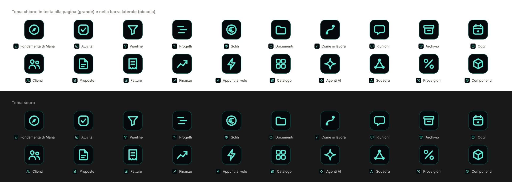
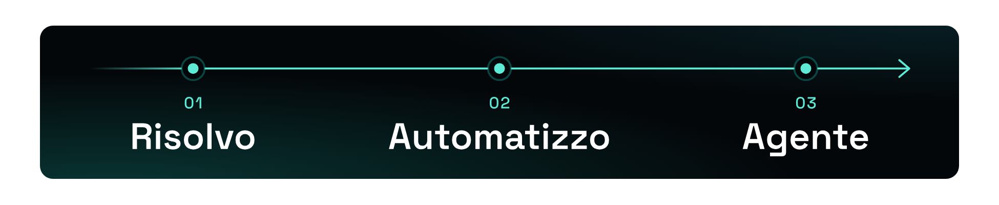
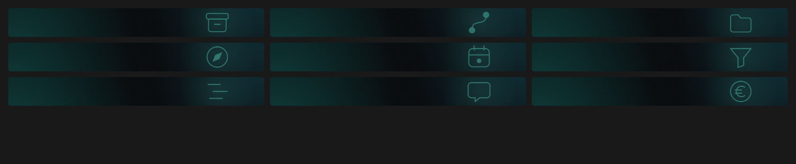

# Mana: kit di marca

Logo, icone, colori e grafiche di Mana ([managroup.ai](https://managroup.ai)), in un posto solo. Da qui li prendono il sito, le proposte e lo spazio di lavoro su Notion.

## Cosa c'è

| Cartella | Contenuto |
| --- | --- |
| `logo/` | Logo completo e marchio in bianco (SVG), icona quadrata (PNG 512) |
| `icone/svg/` e `icone/png/` | 20 icone, riquadro scuro con segno verde acqua. SVG e PNG 512 con sfondo trasparente |
| `grafica/` | Striscia "I tre passi": Risolvo, Automatizzo, Agente |
| `copertine/svg/` e `copertine/jpg/` | 9 copertine per le pagine Notion, una per pagina principale. SVG e JPG 2400 x 960 |
| `anteprima/` | Immagini di anteprima usate in questa pagina |

## Icone

Nomi dei file: `mana-fondamenta`, `mana-come-si-lavora`, `mana-attivita`, `mana-progetti`, `mana-pipeline`, `mana-clienti`, `mana-proposte`, `mana-riunioni`, `mana-soldi`, `mana-fatture`, `mana-finanze`, `mana-documenti`, `mana-catalogo`, `mana-appunti`, `mana-agenti`, `mana-oggi`, `mana-archivio`, `mana-squadra`, `mana-provvigioni`, `mana-componenti`.

Regole del disegno, per aggiungerne altre uguali:

- tela 128 x 128, riquadro `#06090b` con angoli a raggio 30 e bordo `#14b8a6` al 32%;
- segno `#5eead4`, tratto 7,5 con estremi e giunzioni arrotondati, dentro un'area di circa 60 x 60 al centro;
- un solo colore, niente testo.

## Striscia dei tre passi

## Copertine

Nomi dei file: `mana-copertina-fondamenta`, `mana-copertina-come-si-lavora`, `mana-copertina-pipeline`, `mana-copertina-progetti`, `mana-copertina-soldi`, `mana-copertina-documenti`, `mana-copertina-riunioni`, `mana-copertina-archivio`, `mana-copertina-oggi`.

Regole del disegno:

- tela 2400 x 960, fondo `#04070a` con due aloni, verde acqua in basso a sinistra e ciano in alto a destra;
- il segno dell'icona della pagina ripreso in grande sulla destra, tratto sottile, al 36%;
- Notion su computer mostra solo la fascia centrale, circa il 40% dell'altezza: il segno sta tutto lì dentro;
- niente testo.

## Colori

| Uso | Colore |
| --- | --- |
| Fondo | `#000000` |
| Superfici | `#070b0c`, `#0d1214`, `#141a1c` |
| Bordi | `#1b2226`, `#283137` |
| Testo | `#ffffff`, `#a6b0b4`, `#8a9499`, `#6b767b`, `#4b565a` |
| Verde acqua: lavoro automatico | `#14b8a6`, `#5eead4` |
| Ciano: risultato | `#22d3ee`, `#67e8f9` |
| Oro: conferma di una persona, pulsanti principali | `#eab308`, `#facc15` |

Carattere: Space Grotesk.

## Regole d'uso

- Nero, bianco e un solo colore d'accento per volta.
- Il logo non si deforma, non si ricolora e non si mette su fondi chiari senza la versione adatta.
- I file in `icone/png/` e in `copertine/jpg/` sono usati come icone e copertine delle pagine Notion di Mana: non rinominarli e non spostarli, altrimenti spariscono.

## Diritti

Logo, marchio e grafiche sono di Mana Group. Tutti i diritti riservati.
